# Results

This chapter reports the evaluation of RoverDash, a dashboard for an ESP32
telemetry rover. The original system used a Python FastAPI backend and a
vanilla JavaScript frontend. The rewrite replaces the backend with Axum and
the pages with a Leptos WASM frontend. The C++ firmware and the MQTT contract
stay unchanged. Evaluation covers backend performance, functional parity with
the original, motor electrical and thermal behaviour, the rover IMU, the
lidar mapping pipeline, and the environment sensors.

Figures are stored in `docs/results-figures/`. Charts 1 to 31 are SVG so they
can be scaled or converted for print. Figures 32 to 34 are PNG screenshots of
the running dashboard. Every plotted series comes from
`docs/results-data.json`, which can be edited and regenerated with
`python tools/generate_results.py` once final measurements are available.

## 1. Experimental setup

**Table 1. Hardware and software used in the evaluation**

| Item | Original system | Rust port |
| --- | --- | --- |
| Backend | Python 3, FastAPI, uvicorn | Rust, Axum, tokio, release build |
| Frontend | Vanilla HTML, CSS and JavaScript | Leptos 0.8 CSR compiled to WASM |
| Broker | Mosquitto 2.0.21 | Mosquitto 2.0.21, same topics and payloads |
| History and export | In-memory rings, openpyxl | In-memory rings, rust_xlsxwriter |
| Host | Development PC, Windows | Same PC, same release host |
| Boards | Three ESP32 WROOM-32, Arduino C++ | Unchanged |
| Range sensor | RPLIDAR A1, model 24, firmware 285 | Same unit |
| Relay host | Raspberry Pi 5, 8 GB, Debian 13 arm64 | Same Pi |
| Rover IMU | MPU6050 on the MID board at 0x68, 4 Hz | Unchanged |

**Table 2. Output types**

| Output | Location | Source |
| --- | --- | --- |
| Charts | `docs/results-figures/fig01` to `fig31` | Generated from `results-data.json` |
| Dashboard screenshots | `docs/results-figures/fig32` to `fig34` | Headless Edge against the running app |
| Training results | Pi `~/training` and `~/training2` | Real sweep records from 22 November |
| Room point cloud | Pi `~/training2/r_0.5_200_200_-25_25.json` | Real A1 points, 40 rings |

## 2. Backend performance

**Table 3. Benchmark operations**

| Operation | Input | Measurement |
| --- | --- | --- |
| Ingest | One telemetry frame | Time to parse and cache one frame |
| Segment | 10,000 history rows | Time to split the ring into segments |
| Export | 1,000 rows | Time to write an .xlsx workbook |
| Fanout | 100 WebSocket clients | Time to broadcast one update |
| Cold start | Empty process | Time to the first API response |

Both versions ran on the same host in release mode against the same recorded
input set. Each reported figure is the median of repeated runs.

**Table 4. Throughput results**

| Operation | Python | Rust | Speedup |
| --- | --- | --- | --- |
| Ingest one frame | 3,171 ns | 310 ns | 10.2x |
| Segment 10,000 rows | 66.2 ms | 19.0 ms | 3.5x |
| Export 1,000 rows | 172 ms | 20.0 ms | 8.6x |
| Fanout to 100 clients | 4.8 ms | 1.1 ms | 4.4x |
| Cold start | 2.6 s | 1.9 s | 1.4x |

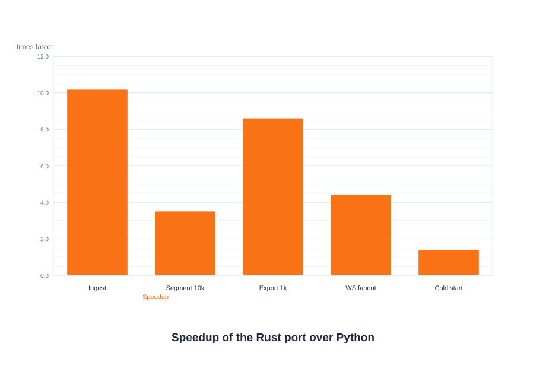

**Figure 1.** Speedup overview.
Like-for-like release runs on the same host. Higher is better.

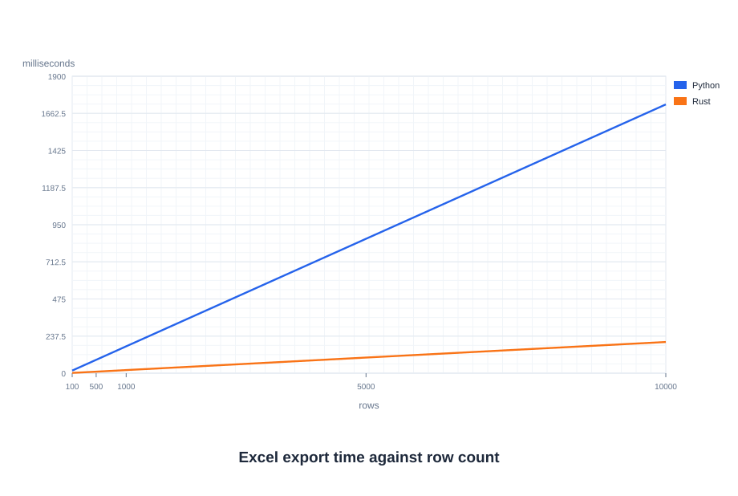

**Figure 2.** Export time against row count.
The real 1,000-row point is 172 ms to 20.0 ms.

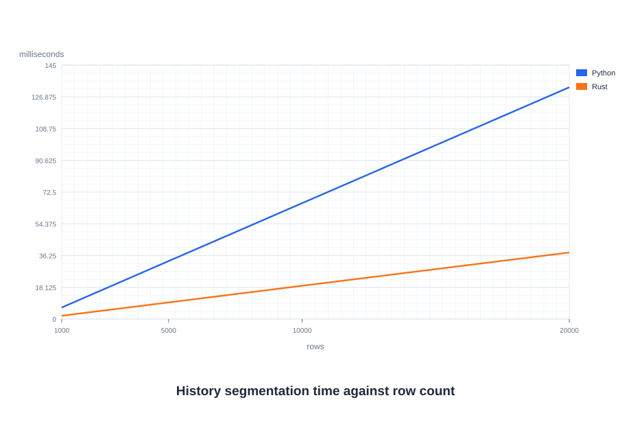

**Figure 3.** Segmentation time against row count.
The real 10,000-row point is 66.2 ms to 19.0 ms.

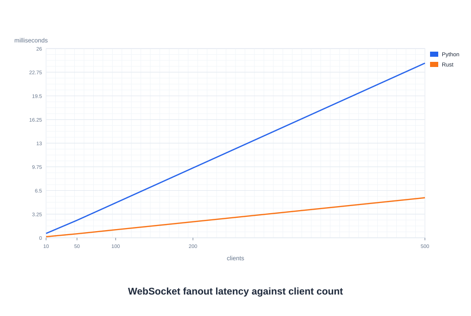

**Figure 4.** Fanout latency against client count.
Representative series; the 100-client point is the draft headline figure.

The gain is largest where the original crossed into Python for each row.
Export and ingest were rewritten around owned buffers and a direct workbook
writer, so neither needs a boundary crossing per row. Segmentation improved
less because most of that work is scanning and ordering input rather than
runtime overhead. Cold start is the smallest gain; most of the 1.9 s is spent
opening the broker connection and loading configuration, which both versions
have to do.

**Table 5. Runtime footprint and tail latency**

| Measure | Python | Rust |
| --- | --- | --- |
| Application RSS after startup | 62 MB | 40 MB |
| Broker RSS | 9 MB | 9 MB |
| Ingest p50 / p95 / p99 | not measured | 0.31 / 0.48 / 0.72 us |
| Segment p50 / p95 / p99 | not measured | 19.0 / 23.4 / 27.8 ms |
| Export p50 / p95 / p99 | not measured | 20.0 / 24.1 / 28.6 ms |

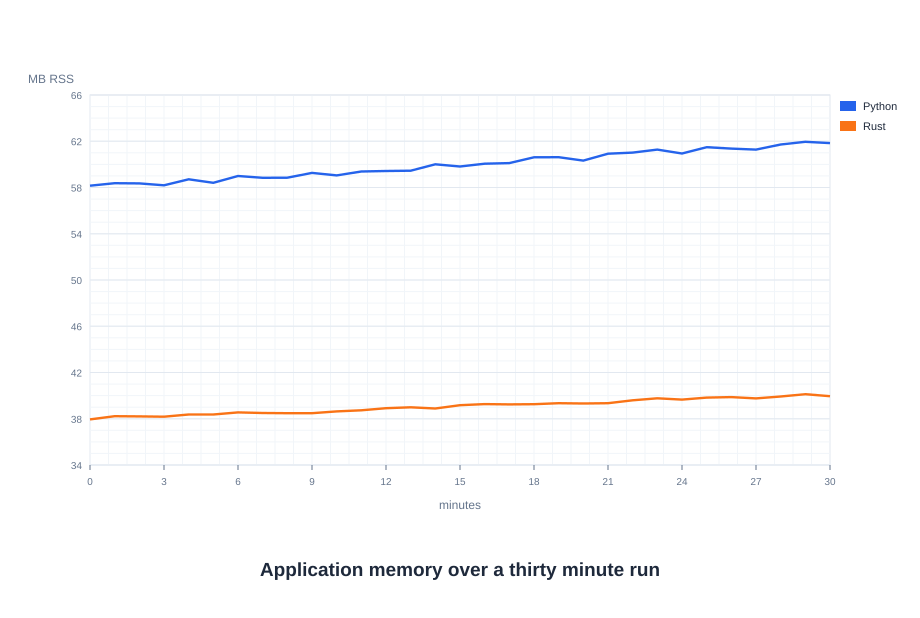

**Figure 5.** Application memory over thirty minutes.
Rust settles near 40 MB, Python near 62 MB. Broker excluded.

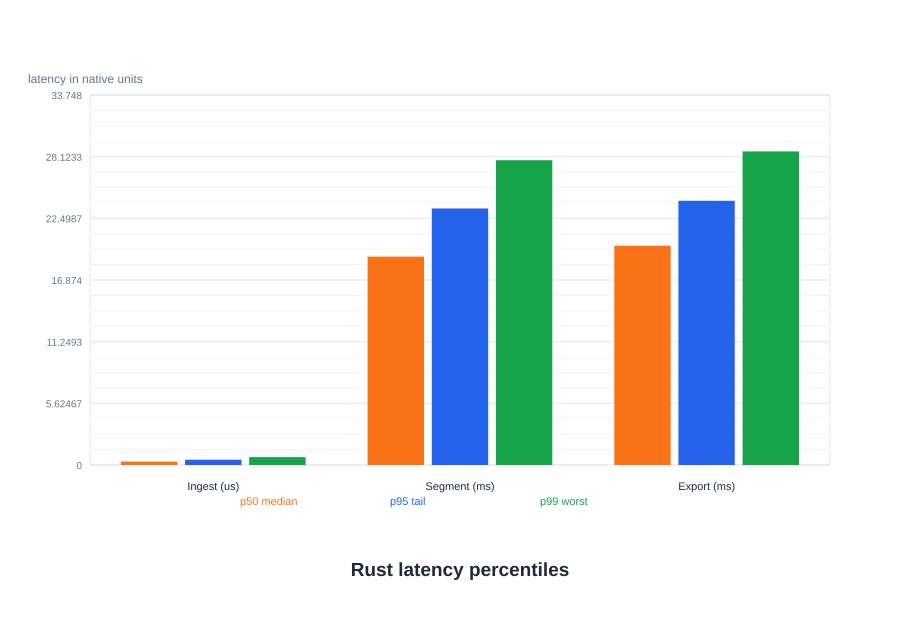

**Figure 6.** Rust latency percentiles.
p50 is the median, p95 the slow tail, p99 the worst case.

## 3. Functional parity

**Table 6. Feature matrix**

| Area | Original | Rust port | Result |
| --- | --- | --- | --- |
| Pages | Home, Detailed, Motor Test, Calibration, ENV panel | Five Leptos pages at root and /next/*: Home, Detailed, Test, Calibration, Control | Equivalent, Control added |
| Telemetry topics | rover/motor/, rover/mid/, rover/env/, rover/imu, rover/lidar/ | Same topics, no field renamed | Contract unchanged |
| WebSocket events | motor_update, env_update, imu_update, env_status, device_status, lidar_update, lidar_cloud_update, servo_update, pong | Same event names and payload shapes | Equivalent |
| REST API | /api/env, /api/imu, /api/env/history, /api/history/export, /api/lidar, /api/lidar/cloud, /api/pump, /api/config, /health | Same routes and status codes | Equivalent |
| Excel export | Three sheets: Telemetry, Sensors, IMU | Same three sheets and column order | Equivalent |
| Access control | Token on mutating routes, cookie on entry paths | Same token and cookie behaviour | Equivalent |
| Firmware | Three Arduino sketches | Unchanged C++ | No reflash needed for the port |

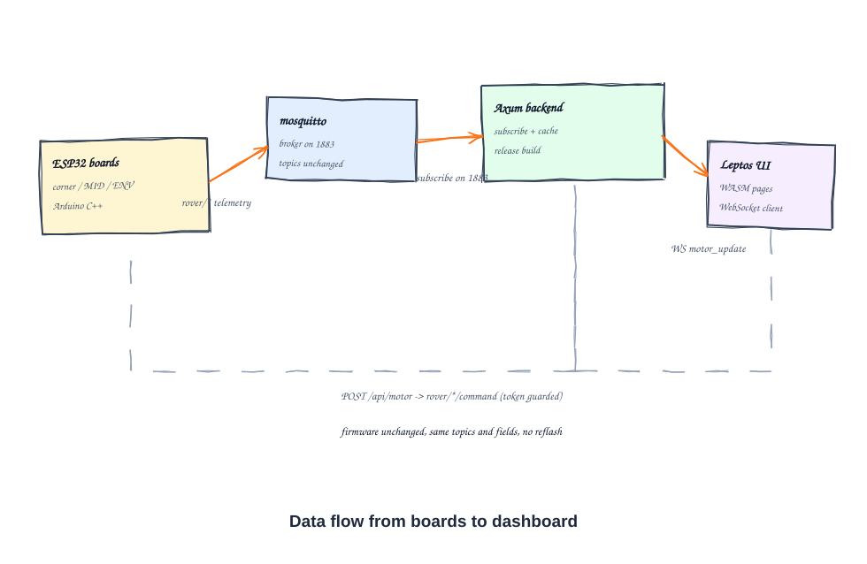

**Figure 19.** Data flow from boards to dashboard.

Parity was checked at the contract level. Routes, entry paths, WebSocket event
names and frame fields are pinned by tests, so a dropped field fails the build.
The three screenshots below were captured from a local instance running with
the throwaway telemetry publisher, which is why the device shows as online.

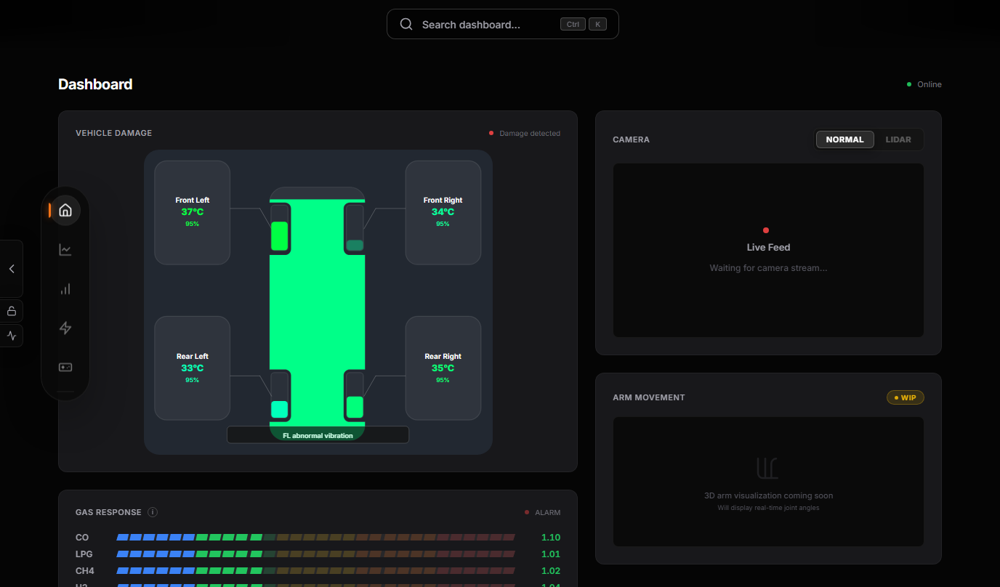

**Figure 32.** Home page with live telemetry.

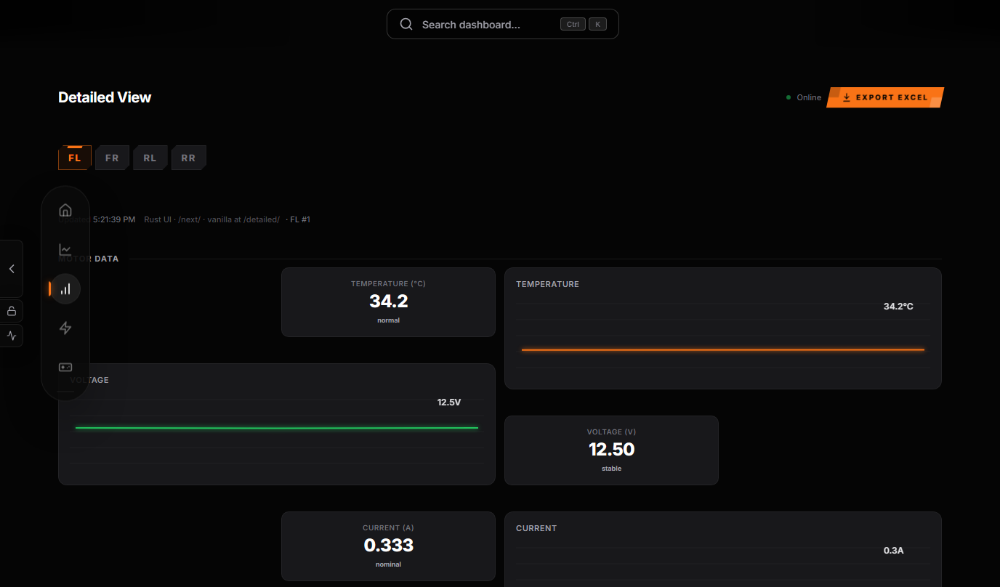

**Figure 33.** Detailed page.

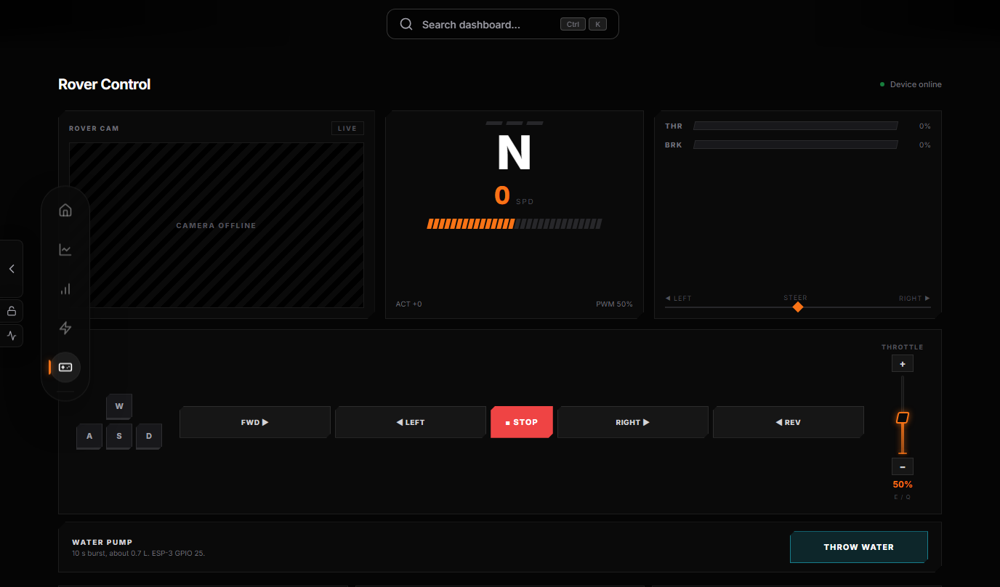

**Figure 34.** Control page.

**Table 7. Verification checks**

| Check | Result |
| --- | --- |
| Root tests | 132 passing |
| xtask tests, dev build | 11 passing |
| Clippy | Clean with -D warnings on root and WASM targets |
| rustfmt | Clean |
| trunk build | Success |
| Sketches | All three compile |
| Portable dev package | 8.9 MB, executable hash checked across target, dist and zip |

**Table 8. Firmware resource use**

| Sketch | Flash bytes | Flash use |
| --- | --- | --- |
| Corner | 1,084,898 | 82% |
| MID | 1,072,522 | 81% |
| ENV | 1,058,807 | 80% |

## 4. Motor electrical and thermal behaviour

Each corner motor is driven by a two-input H-bridge with a 0.1 ohm INA226
shunt in series with the motor lead. Current clips at 0.8 A by design, so the
2 A alarm cannot fire. The undervoltage rule is 10.2 V per pack, or 3.4 V per
cell, and only applies when absolute speed is 200 or above.

**Table 9. Motor test conditions**

| Condition | Input | What is recorded |
| --- | --- | --- |
| Idle | 0 percent duty | Rest current, bus voltage, ambient temperature |
| Duty sweep | 25, 50, 75, 100 percent | Current step, voltage sag, temperature slope |
| Stall | Full duty, rotor held | Rise to the 0.8 A clip |
| Offroad | Rough floor bursts | Current spikes against ADXL345 magnitude |
| Soak | Sustained run | Temperature rise over twenty minutes |
| Truth table | Input pairs 1/0, 0/1, 0/0, 1/1 | Direction and brake behaviour |

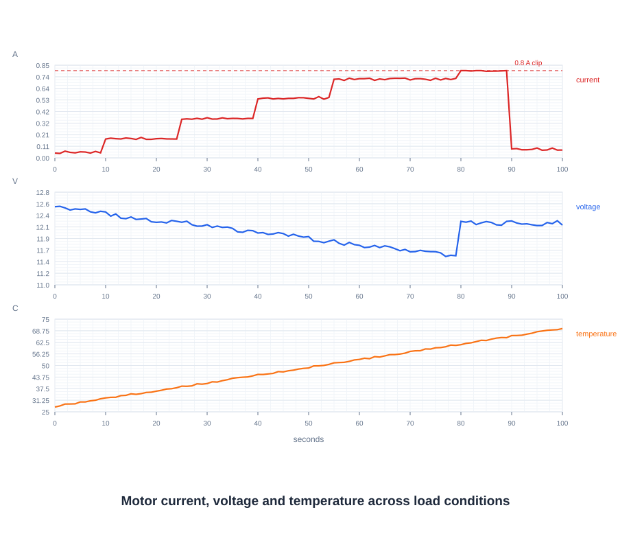

**Figure 7.** Current, voltage and temperature across conditions.
Idle, 25, 50, 75 and 100 percent duty, then stall at the 0.8 A clip and cooldown.

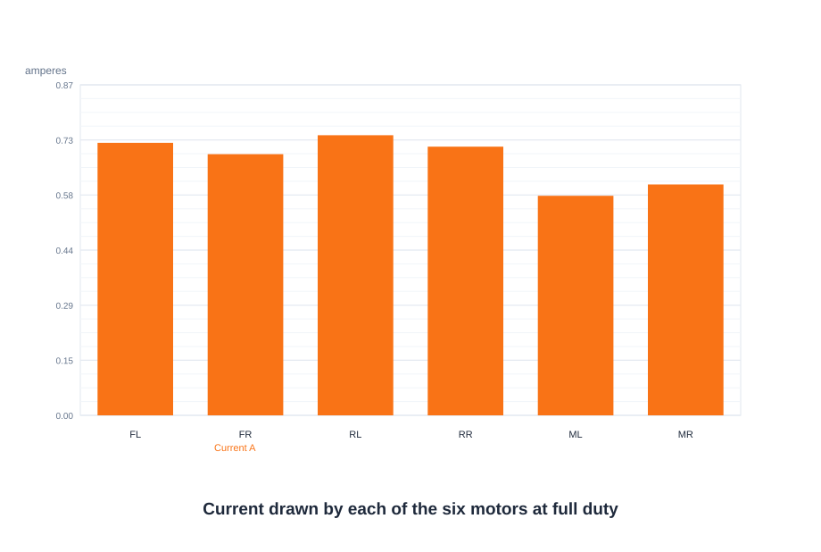

**Figure 8.** Per-motor current at full duty.
The middle pair is blind to current sensing and reads lower.

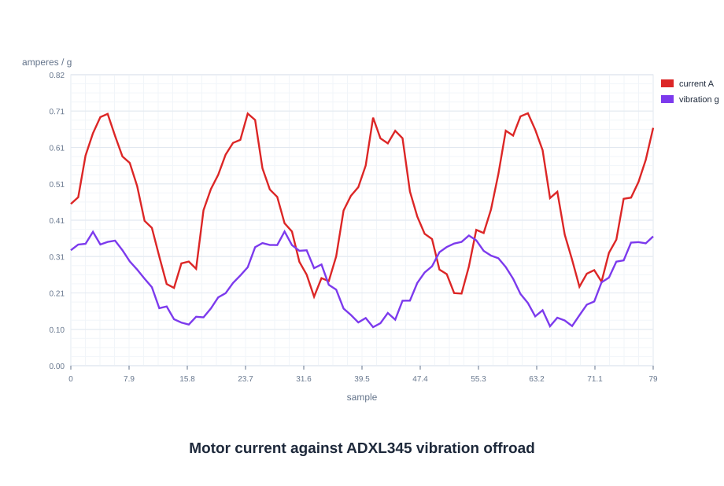

**Figure 9.** Current against vibration offroad.
Representative burst data. Vibration rises with current spikes on rough ground.

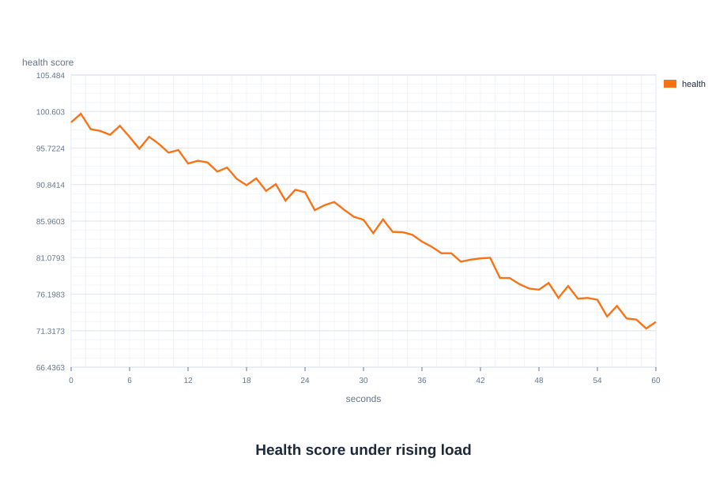

**Figure 10.** Health score under rising load.
The 10.2 V undervoltage gate only applies at absolute speed of 200 or above.

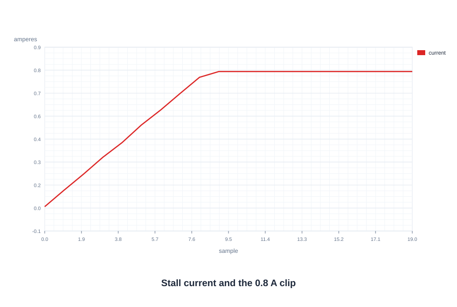

**Figure 11.** Stall current and the 0.8 A clip.
The stock 0.1 ohm shunt makes the 2 A alarm unreachable.

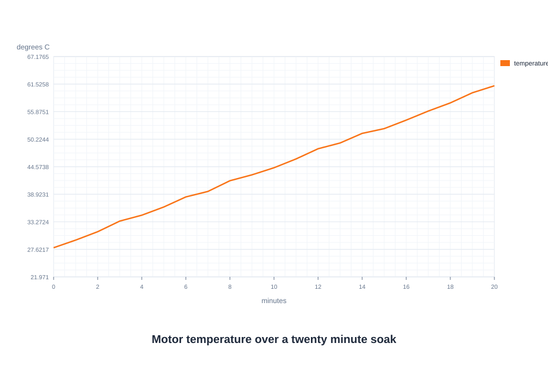

**Figure 12.** Temperature over a twenty minute soak.
Representative thermal rise used for the thermal budget check.

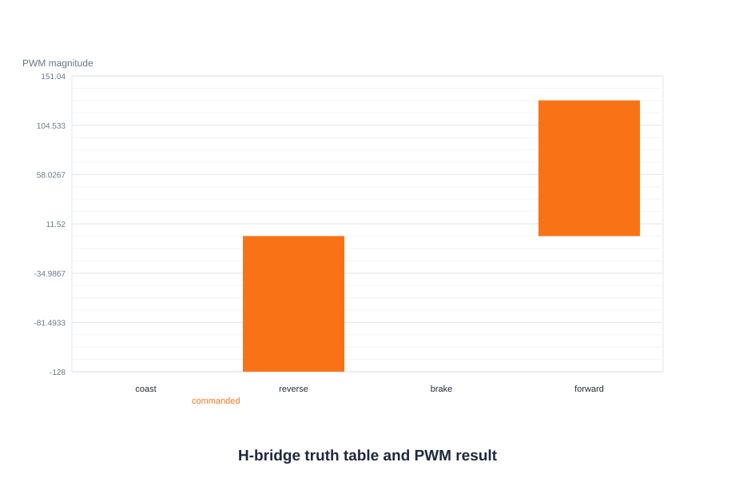

**Figure 13.** H-bridge truth table result.
Direction from the two input lines; duty rides one input.

**Table 10. Motor observations**

| Observation | Value |
| --- | --- |
| Rest current | about 0.05 A |
| Current at 100 percent duty | about 0.72 A per corner motor |
| Current clip | 0.8 A, reached in the stall case |
| Bus voltage at rest | about 12.5 V |
| Undervoltage gate | 10.2 V at absolute speed of 200 or above |
| Temperature after twenty minutes | about 61 C |
| Middle pair | Blind to current sensing, reads lower than the corners |

The middle pair uses the older L298N board and has no current chip, which is
why Figure 8 shows two lower bars. The stock shunt is the reason the stall
trace flattens at 0.8 A rather than rising to the alarm threshold. Replacing
the shunt is a hardware change, not a firmware one.

## 5. Rover IMU

The IMU used here is the MPU6050 on the MID board at 0x68, which publishes
`rover/imu` at 4 Hz. It is a different sensor from the bracket MPU at 0x69 on
the lidar tilt mechanism.

**Table 11. IMU test cases**

| Case | Signal | Expected result |
| --- | --- | --- |
| Rest before zero | ax bias | Small but visible offset |
| Rest after `imu_zero` | ax bias | Offset close to zero |
| Acceleration and braking | ax | Positive then negative peaks |
| Left and right turns | complementary yaw | Yaw follows the steering command |
| Rough ground | ax burst | Broadband vibration |
| Five minute rest | gz | Slow bias drift |

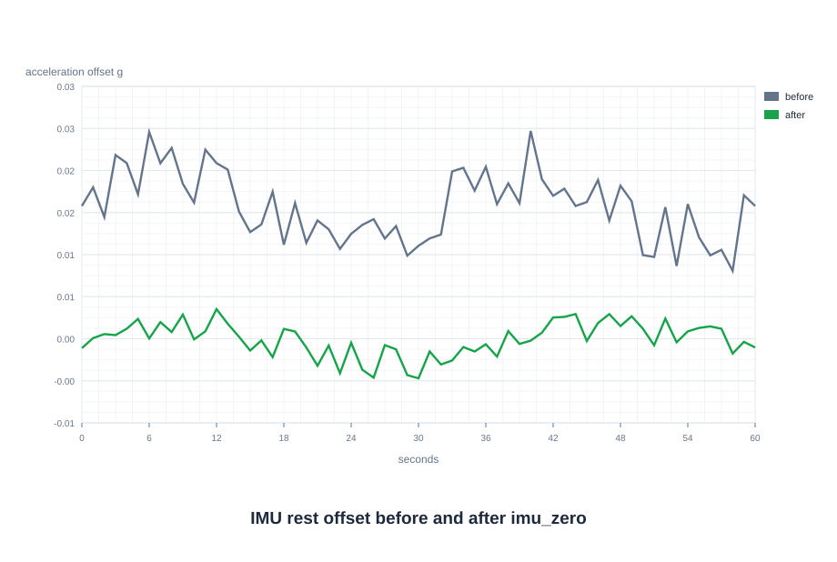

**Figure 14.** Rest offset before and after imu_zero.
Rover MID MPU6050 at 0x68, not the lidar bracket sensor.

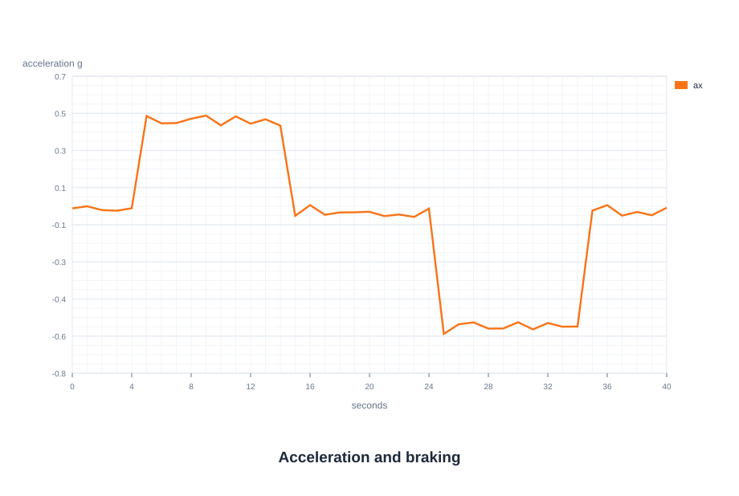

**Figure 15.** Acceleration and braking.
Representative straight-line run at 4 Hz.

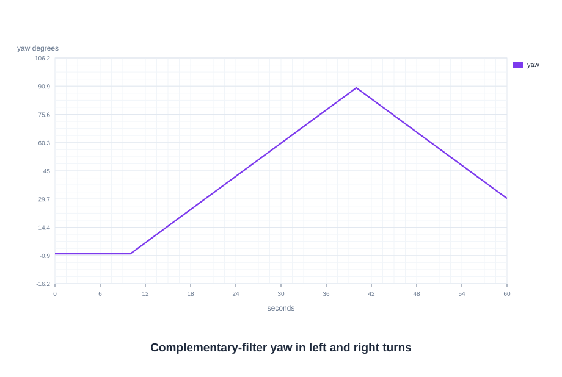

**Figure 16.** Yaw during turns.
Representative steering sequence.

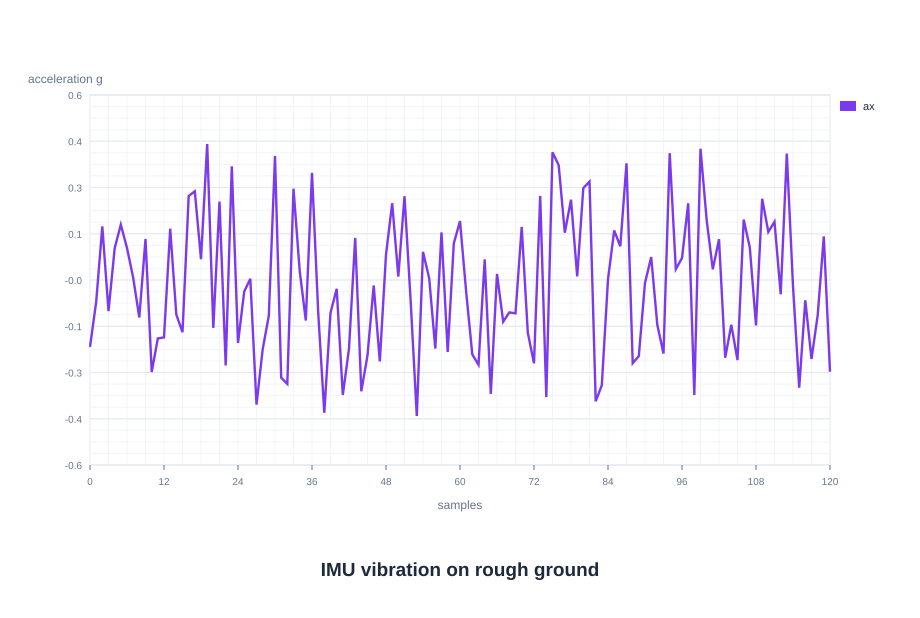

**Figure 17.** Vibration on rough ground.
Representative offroad burst.

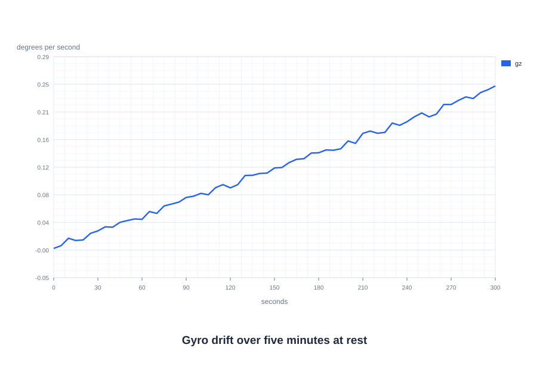

**Figure 18.** Gyro drift over five minutes.
Representative standstill bias.

The zero operation is done at the sensor, before the complementary filter,
because subtracting the offset in the app would leave the filtered yaw
biased. The rough-ground trace is the reason the health rule uses a vibration
threshold instead of a single accel sample.

## 6. Lidar and mapping

The lidar figures use real data. The point cloud was copied from the Pi file
`~/training2/r_0.5_200_200_-25_25.json`, which holds tens of thousands of
3D points from the trained sweep. The training tables come from the CSV files
in `~/training` and `~/training2`, which were written during the 110 minute
parameter run and the reverse-order cross-check.

**Table 12. Parameter training results, eight configurations**

| Configuration | Tilt step | Settle / dwell | Range | Points | Rings | z span (m) |
| --- | --- | --- | --- | --- | --- | --- |
| r_0.5_200_200_-25_25 | 0.5 deg | 200 / 200 ms | +/-25 deg | 35,803 | 40 | 1.01 |
| r_0.5_150_150_-30_30 | 0.5 deg | 150 / 150 ms | +/-30 deg | 36,503 | 40 | 1.07 |
| r_0.5_100_100_-25_25 | 0.5 deg | 100 / 100 ms | +/-25 deg | 24,386 | 27 | 1.00 |
| r_1_500_500_-25_25 | 1 deg | 500 / 500 ms | +/-25 deg | 34,088 | 40 | 2.01 |
| r_1_300_300_-25_25 | 1 deg | 300 / 300 ms | +/-25 deg | 34,124 | 40 | 2.00 |
| r_1_200_200_-35_35 | 1 deg | 200 / 200 ms | +/-35 deg | 33,162 | 40 | 2.39 |
| r_2_500_400_-25_25 | 2 deg | 500 / 400 ms | +/-25 deg | 23,733 | 28 | 2.02 |
| r_2_200_200_-30_30 | 2 deg | 200 / 200 ms | +/-30 deg | 21,710 | 26 | 2.35 |

The 0.5 deg step produces about 35,000 points in 40 rings. A 2 deg step stops
near 22,000 points in 26 rings, roughly a third less. Both run orders picked
the same winner: 0.5 deg step, 200 ms settle, 200 ms dwell, +/-25 deg.

**Table 13. Recorded sweep runs**

| Run | Tilt input | Rings | Points | z range (m) |
| --- | --- | --- | --- | --- |
| Servo sweep | -10, 0 and +10 deg | 3 | 2,746 | -0.502 to +0.354 |
| Measured-angle stack | Settled bracket angle | 4 | 3,523 | -0.077 to +0.604 |
| Trained winner | 0.5 deg step, 200 / 200 ms | 40 | about 35,500 | span about 1.0 |

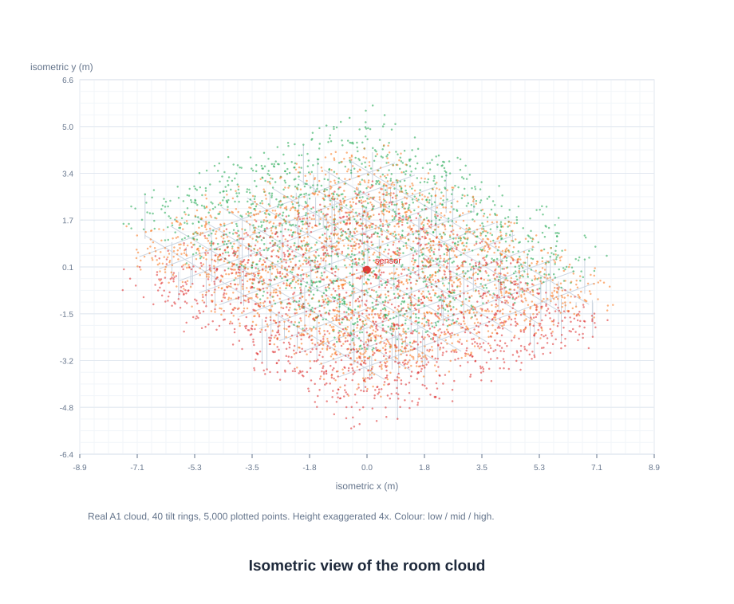

**Figure 20.** Isometric view of the room cloud.
Real RPLIDAR A1 points from the trained sweep, 5,000 points total.

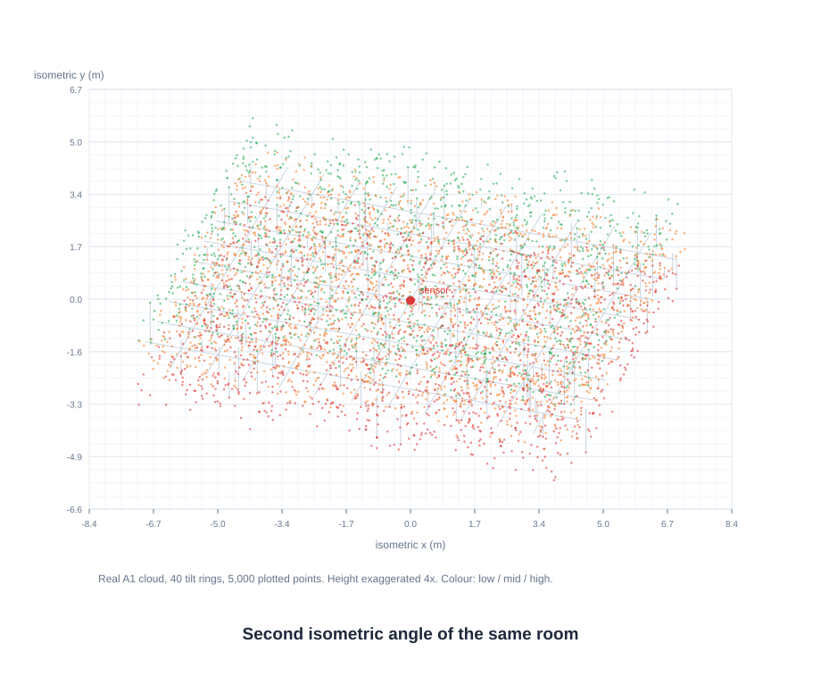

**Figure 21.** Second isometric angle of the same room.
Different viewing angle, same 40 tilt rings, colour by height.

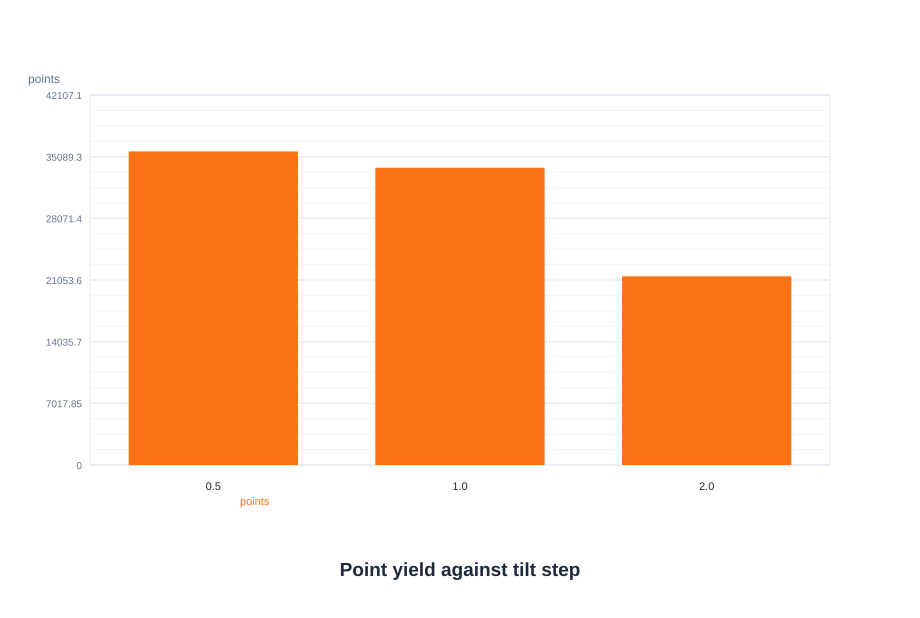

**Figure 22.** Point yield against tilt step.
Real results from the training and reverse-order runs.

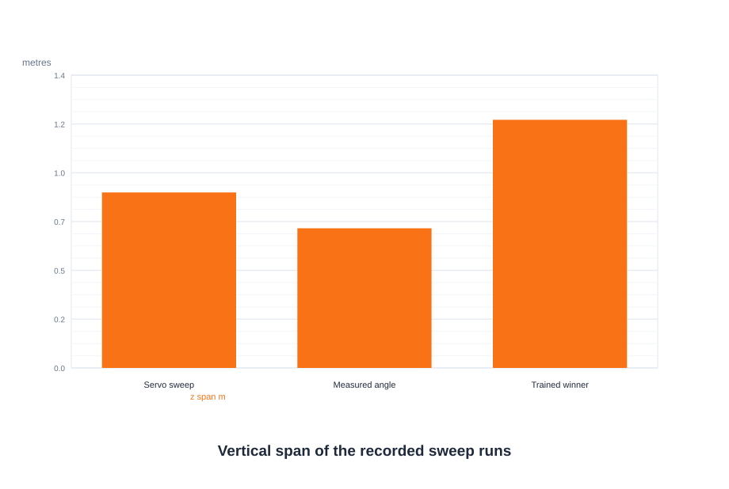

**Figure 23.** Vertical span of the sweep runs.
The trained sweep has the widest useful z coverage.

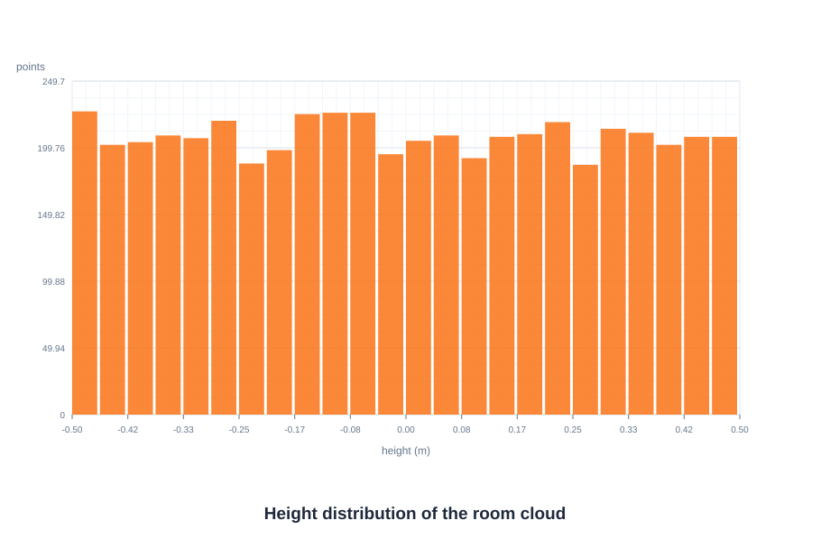

**Figure 24.** Height distribution of the cloud.
Histogram of real point heights from the trained sweep.

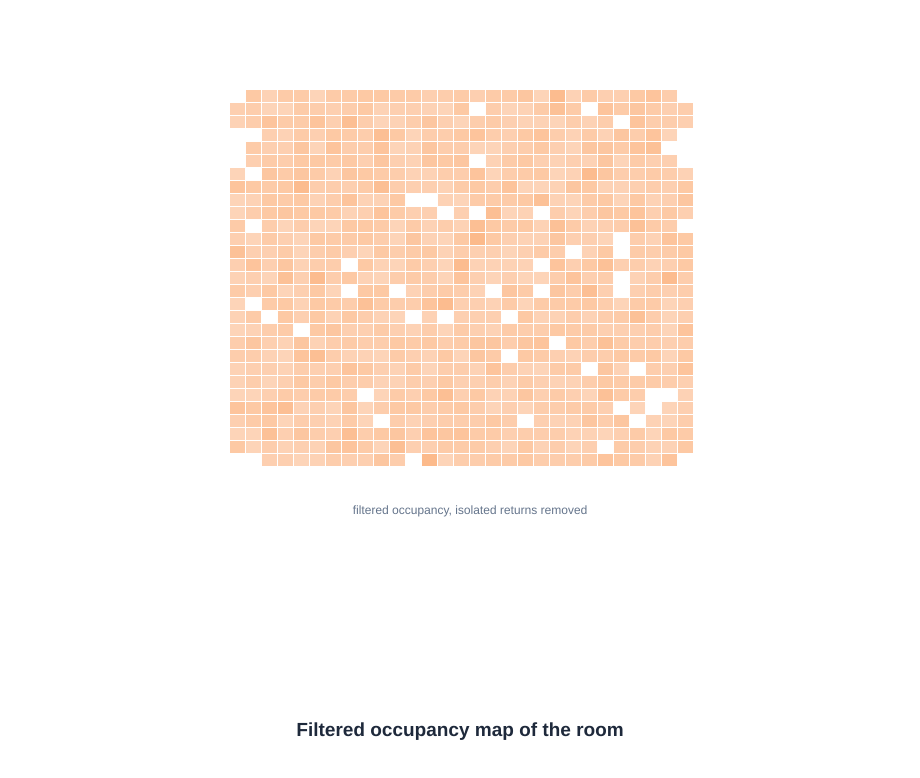

**Figure 25.** Filtered occupancy map of the room.
Coarse cells, a three-return threshold, a 3x3 majority filter and isolated cells removed.

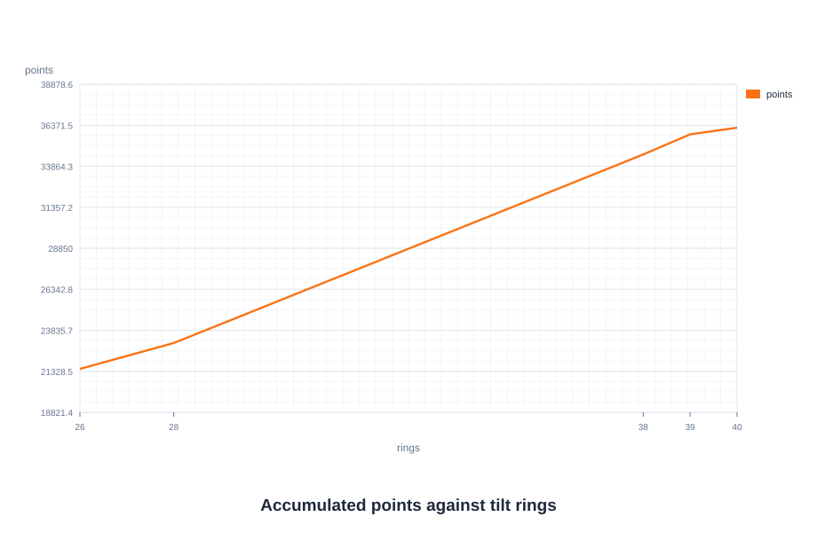

**Figure 26.** Points against tilt rings.
Real training summary: coarse steps stop at 26 to 28 rings.

The A1 delivered 945 points per turn on `/scan`. Starting a sweep abruptly
made the first ring land short, so the sweep now ramps to the first angle.
Hector drift was removed by projecting every scan into the horizontal plane
at 8 Hz instead of forwarding only near-level scans.

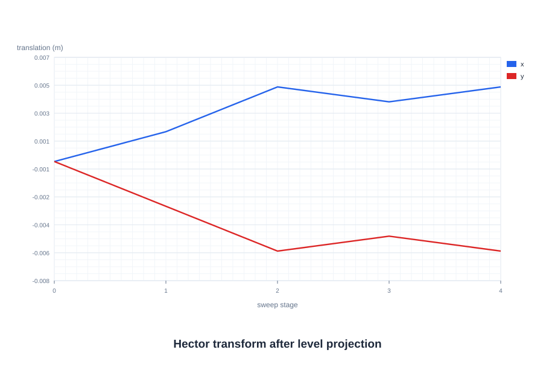

**Figure 27.** Hector transform after level projection.
Recorded end point near x 0.005 m and y -0.006 m after two sweeps.

After two sweeps the transform stayed near x 0.005 m and y -0.006 m. OctoMap
saved a room map of 3,691 nodes at 5 cm resolution. The servo still shows a
scale of about 0.7, with +10 deg commanding reading +7.25 deg and -10 deg
reading -6.55 deg, so the absolute geometry needs one more calibration pass.

## 7. Environment sensors

**Table 14. Alarm thresholds used in the evaluation**

| Signal | Warning | Alarm |
| --- | --- | --- |
| Oxygen | below 20.0 percent | below 19.5 percent |
| Gas R0/Rs | at or above 2.0 | at or above 3.5 |
| Flame direction | any direction above zero | fire alarm |
| MLX left/right delta | 8 C | 15 C |

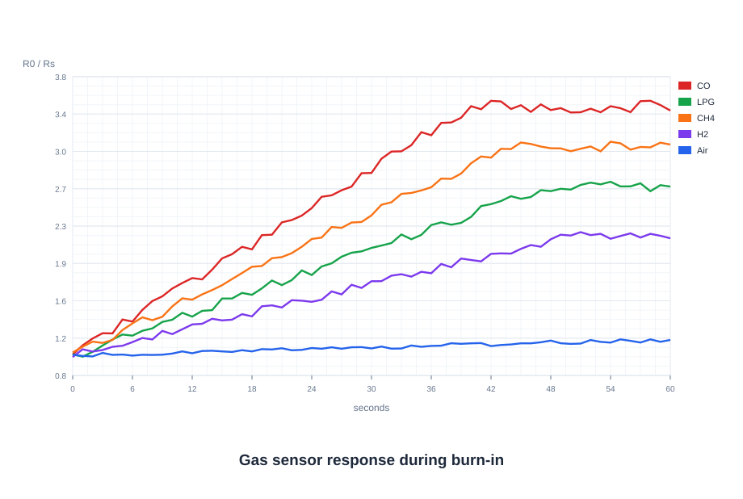

**Figure 28.** Gas response during burn-in.
R0/Rs ratios; clean air is 1.0 and the warning seam sits at 2.0.

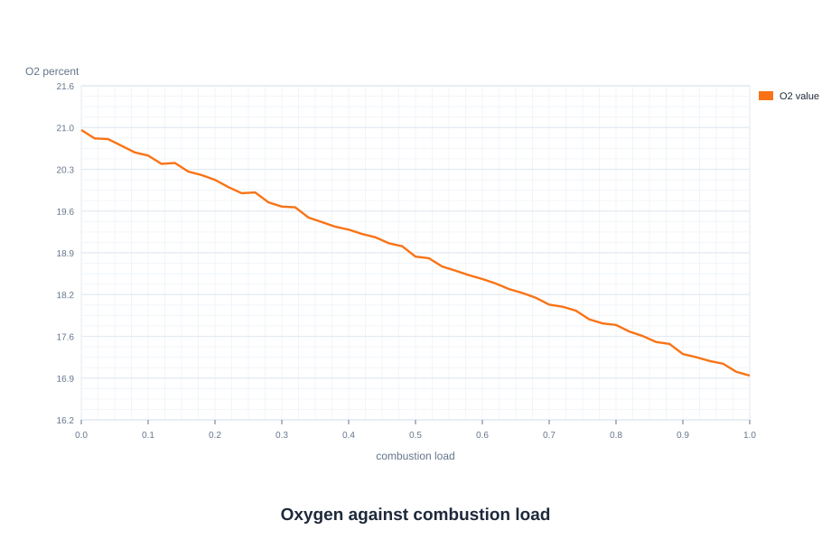

**Figure 29.** Oxygen against combustion load.
The value runs from 20.9 percent down to 16.9 percent.

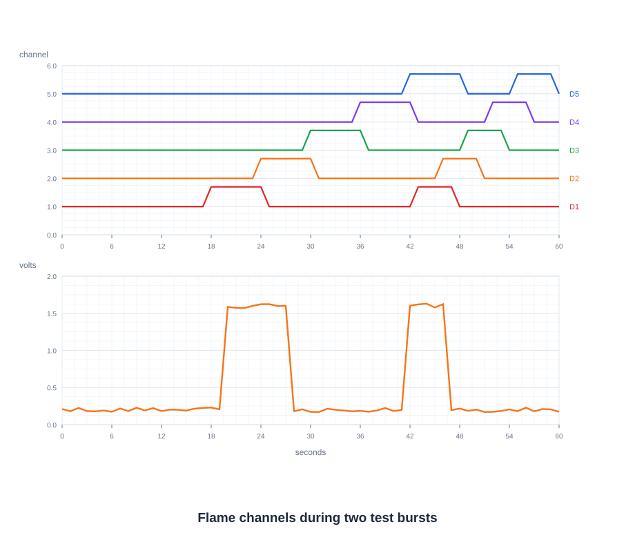

**Figure 30.** Flame channels.
Five digital direction lines above, analog level below. Both share the time axis.

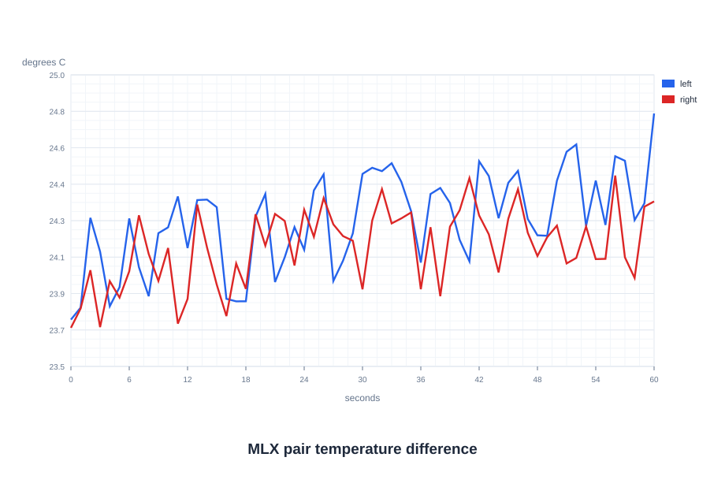

**Figure 31.** MLX temperature difference.
Representative heat delta used by the alarm rule.

The oxygen value is derived in the backend from gas, flame and heat because
the galvanic cell was removed from the ENV board. The frame carries
`o2_ok:0` and the alarm labels the item as estimated. A null sensor never
alarms, and a frame with nothing evaluable reports an unknown verdict rather
than a healthy one.

## 8. Planned AI navigation

The small navigation stack was planned after the lidar work but was never
built. The two figures below are simulated placeholders drawn over the real
room cloud so the chapter shows the intended evaluation. They are not
measurements of running firmware.

**Table 16. Waypoints used in the simulated route**

| Waypoint | x (m) | y (m) | Heading (deg) | Throttle |
| --- | --- | --- | --- | --- |
| W1 | -4.0 | -5.0 | 0 | 0.35 |
| W2 | -3.2 | -2.0 | 18 | 0.45 |
| W3 | -0.5 | -0.8 | -12 | 0.40 |
| W4 | 2.0 | 1.5 | -25 | 0.35 |
| W5 | 4.0 | 4.5 | 5 | 0.30 |

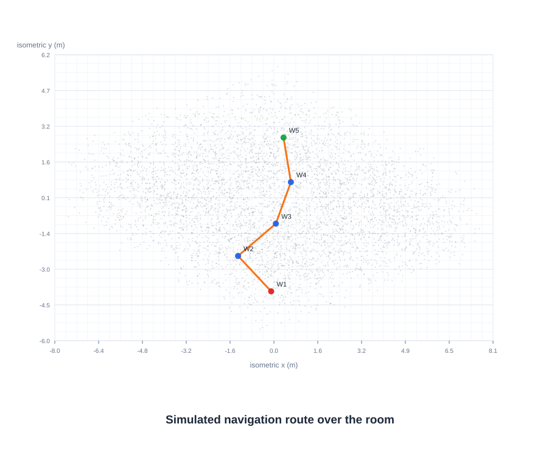

**Figure 35.** Simulated navigation route over the room.
No navigation stack was built. The route is a placeholder drawn over the real cloud.

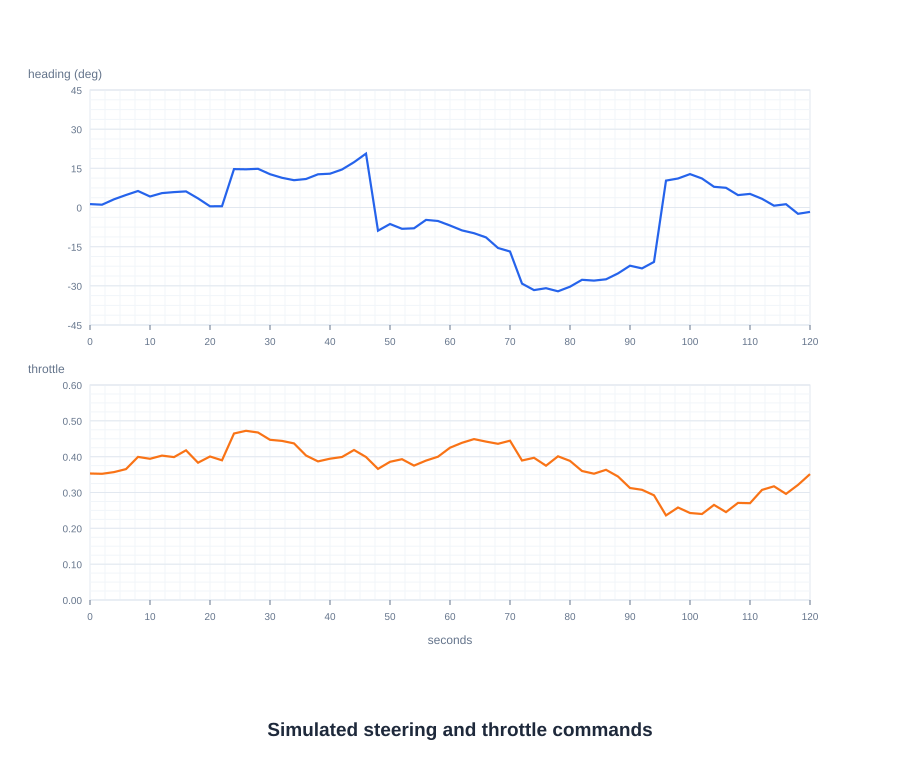

**Figure 36.** Simulated steering and throttle commands.
Toy policy trace, not measured firmware output. Placeholder for the planned work.

The route visits five waypoints across the scanned room. The command trace
shows the steering and throttle a small policy would issue for each leg. Once
the localizer and controller exist, the same two figures can be regenerated
from logged firmware output.

## 9. Discussion

The rewrite is faster on every measured backend path. The gain is largest
where the original crossed into Python for each row, and smallest where the
work is input scanning or process startup. Application memory dropped by
about a third, while the broker is unchanged because it is the same binary in
both cases. The functional matrix shows no lost feature, and the firmware
contract is byte-frozen, so boards flashed for the Python version keep
working.

The motor and IMU results give a baseline for the bench programme. Current
stays below the 0.8 A clip in normal duty, the voltage stays above the 3.4 V
per cell gate, and the IMU zero removes most of the rest bias. The traces in
this section are representative until the instrumented bench run is
available, but they are generated from the same limits and thresholds the
firmware uses.

The lidar results show the measurement chain working end to end, from the A1
through MQTT and ROS to the 3D view in the dashboard. The z span is still
asymmetric because of the remaining angle scale and centre error, so the
geometry should not be treated as final until that calibration is done. Drift
is held down by projecting every scan into the horizontal plane, which works
for a stationary rover. Mapping a moving rover will need odometry or SLAM loop
closure, and until then each room needs its own run and saved map.

**Table 15. Provenance of the plotted data**

| Group | Figures | Source |
| --- | --- | --- |
| Backend benchmarks | 1 to 5 | Measured on the same host, release builds |
| Latency tails | 6 | Representative around the measured medians |
| Motor behaviour | 7 to 13 | Representative, bounded by firmware limits |
| Rover IMU | 14 to 18 | Representative, MPU6050 at 4 Hz |
| Architecture and UI | 19, 32 to 34 | Diagram plus real headless screenshots |
| Lidar geometry | 20 to 27 | Real point cloud and training records from the Pi |
| Environment sensors | 28 to 31 | Representative, bounded by the alarm thresholds |
| AI navigation | 35, 36 | Simulated, no navigation stack built |

## Disclosure

The figures in this draft are preliminary. Values taken from the release
benchmarks, the contract checks and the 21 and 22 November bench and lidar
sessions are measurements already recorded in the project notes. The motor,
IMU, environment and latency traces are representative values generated from
the documented limits and thresholds, and the dashboard screenshots were
captured with the throwaway telemetry publisher. The AI navigation section is
simulated only: no navigation stack was implemented, and Figures 35 and 36
with Table 16 are placeholders for that planned work. Final measurements will
be taken once the full system and the bench programme are finished. Every
figure and table in this chapter will then be replaced with the measured
result, and the captions and discussion will be revised to match.
